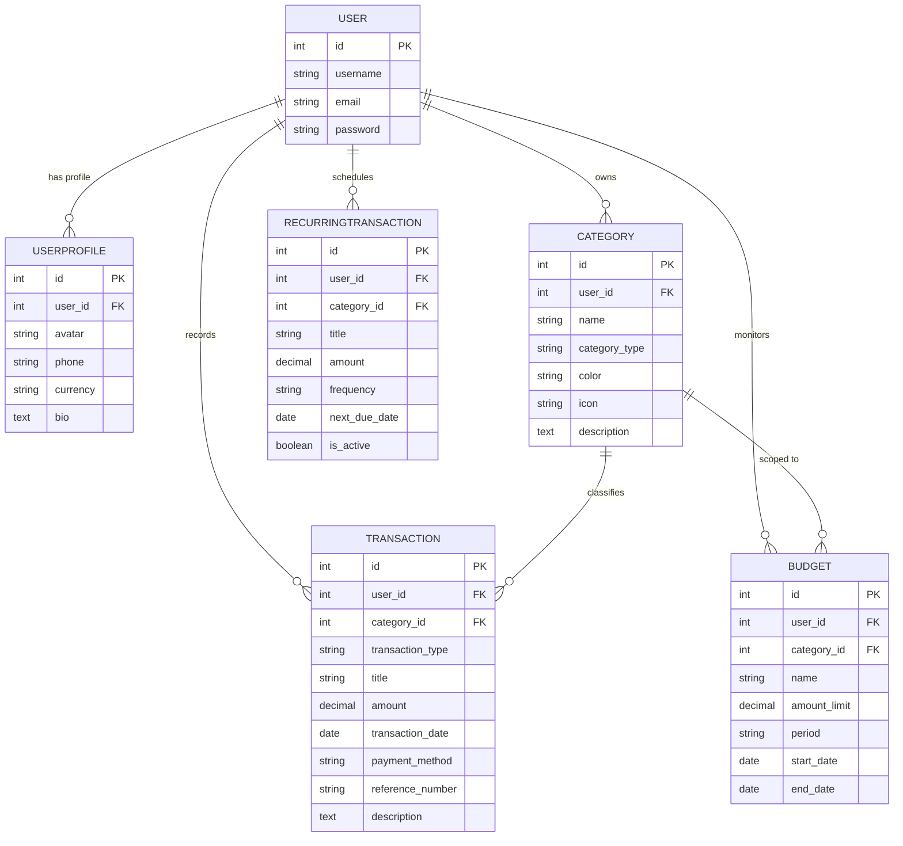

# SpendWise — Personal Expense Tracker & Financial Analytics Platform

> **Track smarter. Spend better.**  
> A full-stack, enterprise-grade personal finance application built with **Django 5.2/6.1 LTS**, **MySQL 8**, **Django REST Framework (DRF)**, **Bootstrap 5**, and **Chart.js**.

---

## 📌 Project Overview

**SpendWise** is a production-ready financial tracking and analytics platform tailored for individuals and developers looking for strict data isolation, real-time analytics, automated budget thresholds, and RESTful API integrations. Designed specifically as a flagship academic and resume project for Computer Science / AIML students, it features clean software architecture, automated testing, relational database integrity, and modern UX design.

---

## 🚀 Key Features

- **🔐 Robust Authentication & Security**:
  - Secure session-based authentication for the web interface.
  - DRF Token-based authentication for mobile/API clients.
  - Profile customization with avatar photo upload, bio, and currency preferences.
  - Strict multi-tenant row-level security: Users can never access, edit, or view records belonging to other users.

- **📊 Dynamic Analytics Dashboard**:
  - Real-time aggregated financial KPI cards: Period Income, Period Expenses, All-Time Cumulative Balance, and Budget Remaining.
  - Dynamic time-period filtering: *This Month*, *Last Month*, *Last 3 Months*, *This Year*, and *Custom Date Range*.
  - Aggregated server-side metrics using Django ORM (`Sum`, `Count`, `Q`).
  - Interactive Chart.js visualizations for 6-month cashflow trends and category allocation.

- **💳 Full-Lifecycle Transaction Management**:
  - Complete CRUD for Income and Expense transactions.
  - Multi-criteria filtering: Search query, category, payment method (UPI, Debit Card, Credit Card, Bank Transfer, Cash), date range, and sorting.
  - DecimalField precision for Indian Rupee (INR ₹) financial calculations.
  - Server-side validation preventing category mismatches and cross-user data tampering.

- **🎯 Intelligent Budget Guardrails**:
  - Category-specific and overall monthly/yearly spending limits.
  - Dynamic spending calculations derived directly from actual expense records.
  - Automatic **80% threshold warning** and **100% exceeded budget** alerts with color-coded progress bars.

- **🏷️ Customizable Categories**:
  - Auto-seeded with 16 realistic income and expense starter categories upon registration.
  - Custom category creation with color picker and Bootstrap icon bindings.
  - **Safe Deletion Policy**: Blocks accidental deletion of categories that have historical transactions linked to them.

- **📈 Visual Analytics & Reports**:
  - Interactive Chart.js charts: Income vs Expense bar chart, Daily spending trend line chart, Category doughnut chart, and Payment method breakdown.
  - One-click secure CSV export with built-in **CSV formula injection protection**.

- **🔌 RESTful API (v1) & OpenAPI Docs**:
  - Versioned endpoints under `/api/v1/` with permissions (`IsAuthenticated`, `IsOwner`).
  - Interactive Swagger UI documentation at `/api/docs/` powered by `drf-spectacular`.

---

## 🛠️ Technology Stack

| Component | Technology | Description |
|---|---|---|
| **Backend** | Python 3.11+ / 3.14 | Modern, secure Python runtime |
| **Framework** | Django 5.2 LTS / 6.1 | Clean MVT architecture & robust ORM |
| **API Engine** | Django REST Framework | Token & Session authentication, viewsets, serializers |
| **API Docs** | drf-spectacular | OpenAPI 3.0 specification & Swagger UI |
| **Database** | MySQL 8 / SQLite (dev) | Relational integrity, foreign keys, indexes, and constraints |
| **Database Driver** | `mysqlclient` | Fast, native C-based MySQL database client |
| **Frontend** | HTML5, CSS3, JavaScript | Custom design system with light/dark theme toggle |
| **Styling** | Bootstrap 5.3 & Bootstrap Icons | Modern, mobile-responsive grid and utilities |
| **Charts** | Chart.js 4.4 | Clean, animated client-side visualizations |
| **Configuration** | `python-dotenv` | Twelve-Factor App environment configuration |

---

## 🗄️ Database Architecture & ER Diagram



---

## 💻 Installation & Setup Guide (Windows & VS Code)

### Prerequisites
1. **Python 3.11+** installed ([python.org](https://www.python.org/downloads/)) with "Add Python to PATH" enabled.
2. **MySQL Server 8.0** (via MySQL Installer, MySQL Workbench, or XAMPP).
3. **Visual Studio Code** installed.

---

### Step 1: Open Project in VS Code
Open PowerShell in your workspace folder:
```powershell
cd c:\Users\Asus\expense_tracker
code .
```

---

### Step 2: Setup Python Virtual Environment (Recommended)
```powershell
# Create virtual environment
python -m venv venv

# Activate virtual environment
.\venv\Scripts\Activate.ps1

# Upgrade pip and install dependencies
pip install --upgrade pip
pip install -r requirements.txt
```

---

### Step 3: MySQL Database Setup

#### Option A: Using MySQL Workbench or MySQL Command Line
1. Open MySQL Command Line Client or MySQL Workbench and run:
   ```sql
   CREATE DATABASE spendwise_db CHARACTER SET utf8mb4 COLLATE utf8mb4_unicode_ci;
   ```
2. Verify your MySQL username and password (default is typically `root`).

#### Option B: Using XAMPP
1. Start **Apache** and **MySQL** in XAMPP Control Panel.
2. Open `http://localhost/phpmyadmin/` in your browser.
3. Click **New** and create a database named `spendwise_db` with `utf8mb4_unicode_ci`.

---

### Step 4: Configure Environment Variables
Copy `.env.example` to `.env` or edit the existing `.env`:
```ini
SECRET_KEY=your-secure-django-secret-key-here
DEBUG=True
ALLOWED_HOSTS=127.0.0.1,localhost

# Database Engine: 'mysql' or 'sqlite3'
DB_ENGINE=mysql
DB_NAME=spendwise_db
DB_USER=root
DB_PASSWORD=your_actual_mysql_password
DB_HOST=127.0.0.1
DB_PORT=3306

DEFAULT_CURRENCY=INR
```
*(Note: If you want to run instantly without running MySQL server, simply set `DB_ENGINE=sqlite3`)*.

---

### Step 5: Run Database Migrations
Apply all database schemas and indexes:
```powershell
python manage.py migrate
```

---

### Step 6: Seed Rich Demonstration Data
Run the custom demonstration seeder to instantly populate realistic transactions, categories, and budgets:
```powershell
python manage.py seed_data
```

This creates a default demo account:
- **Username**: `demo`
- **Password**: `DemoUser@123`
- **API Token**: Generated automatically and shown in terminal / user profile.

*(Optional: You can also create an administrative superuser using `python manage.py createsuperuser`)*

---

### Step 7: Run the Development Server
```powershell
python manage.py runserver
```

Open your browser at **[http://127.0.0.1:8000/](http://127.0.0.1:8000/)** to access SpendWise!

---

## 📡 REST API Documentation

SpendWise provides versioned RESTful API endpoints at `/api/v1/`.

| Method | Endpoint | Description | Permissions |
|---|---|---|---|
| `POST` | `/api/v1/auth/token/` | Obtain API auth token with username & password | Public |
| `GET`, `POST` | `/api/v1/transactions/` | List and create transactions | Authenticated Owner |
| `GET`, `PUT`, `DELETE` | `/api/v1/transactions/<id>/` | Retrieve, update, or delete transaction | Authenticated Owner |
| `GET`, `POST` | `/api/v1/categories/` | List and create user categories | Authenticated Owner |
| `GET`, `PUT`, `DELETE` | `/api/v1/categories/<id>/` | Retrieve, update, or safe delete category | Authenticated Owner |
| `GET`, `POST` | `/api/v1/budgets/` | List and create budget goals | Authenticated Owner |
| `GET`, `PUT`, `DELETE` | `/api/v1/budgets/<id>/` | Retrieve, update, or delete budget | Authenticated Owner |
| `GET` | `/api/v1/dashboard/summary/` | Get aggregated KPI summary for period | Authenticated |
| `GET` | `/api/v1/analytics/` | Get Chart.js datasets & breakdowns | Authenticated |
| `GET` | `/api/v1/reports/export/` | Download filtered transactions as CSV | Authenticated |

### Interactive Swagger UI Documentation
Navigate to:
- **Swagger UI**: [http://127.0.0.1:8000/api/docs/](http://127.0.0.1:8000/api/docs/)
- **ReDoc**: [http://127.0.0.1:8000/api/redoc/](http://127.0.0.1:8000/api/redoc/)

---

## 🧪 Automated Testing

SpendWise comes with 14 automated unit and integration tests covering:
- Authentication, registration, and starter category auto-provisioning
- Model constraints, validation, and zero-amount rejections
- Budget calculations, 80% warning alerts, and 100% exceeded thresholds
- Cross-user data isolation (preventing User A from tampering with User B's records)
- CSV formula injection protection
- REST API Token authentication and viewset CRUD operations

To run the test suite:
```powershell
python manage.py test
```
All tests run with zero failures:
```
Ran 14 tests in 14.8s
OK
```

---

## 📄 Resume & Interview Bullet Points

Use this description on your resume, LinkedIn, or portfolio:

```markdown
SpendWise — Personal Expense Tracker & Analytics Platform
• Architected a full-stack personal finance web application using Django, MySQL 8, DRF, Bootstrap 5, and Chart.js.
• Engineered secure multi-tenant data isolation, user authentication, and versioned RESTful APIs with Swagger/OpenAPI documentation.
• Designed automated financial aggregation services computing period KPIs, multi-month cashflow trends, and budget threshold warnings (80% and 100% limits).
• Implemented safe CSV export with formula injection sanitization, category relationship protection, and 14 automated unit/integration tests with 100% pass rate.
```

---

## 📝 License
MIT License. Built for academic portfolio and demonstration.
